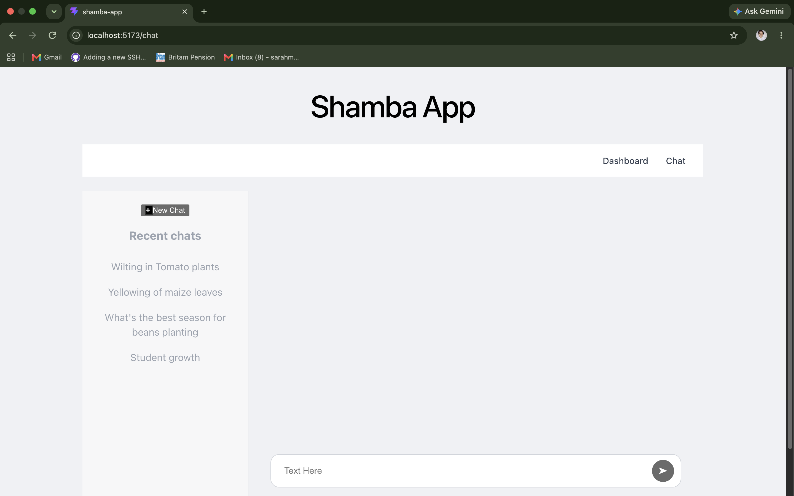
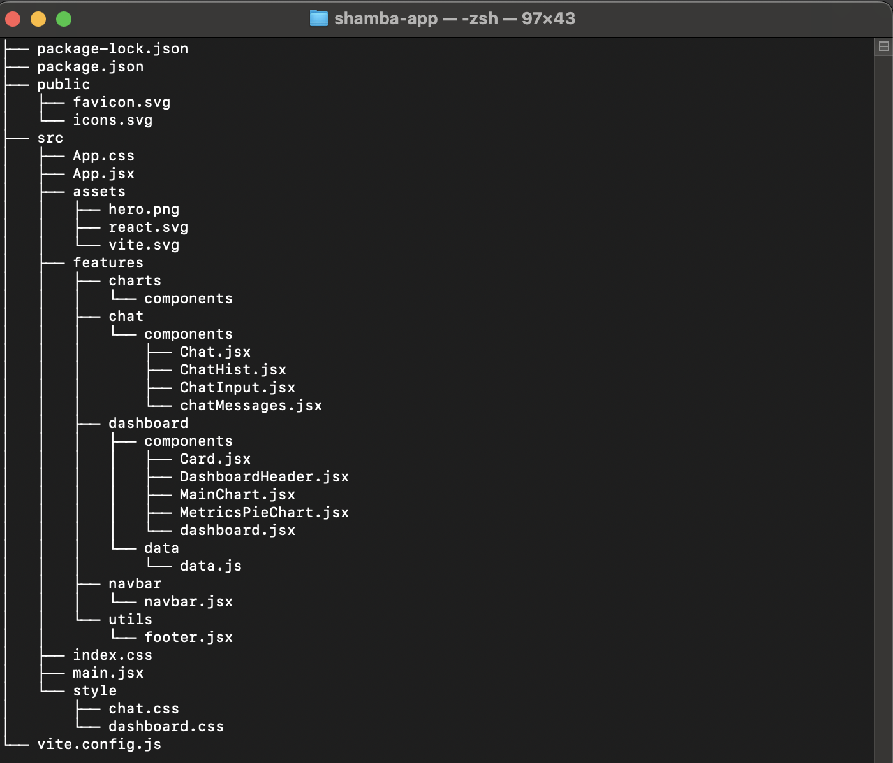

## ShambaGuide: An AI Powered Agri-tech System for localized farming insights

## Description

Shamba Guide is a react.js appplication that provides a chatbot for farmers to interract and get AI-based agriculture advisories and recommendations. 
The application also provides a dashboard for agriculture stakeholders to understand what are the main pain-points that farmers are experiencing based on the frequency of questions asked. 

## Features
##### 1. Dashboard
##### 2. AI Chatbot

## Project Structure

## Prerequisites

<code>node version >= 22.0.1</code>

## Installation
To execute the react application follow the steps below: 

###### Step 1. git clone https://github.com/CMU-Bootcamp-G20/Shamba-Guide.git

###### Step 2. cd frontend/shamba-app

###### Step 3. npm install

###### Step 4. npm run dev 

## Dependencies
We expect the data below and endpoints from the backend
#### 1. API Overview

The FastAPI backend will expose four primary endpoints:

<table>

<th>Method	Endpoint	Purpose</th>
<tr><td>POST</td><td>/api/chat</td>	<td>Submit an agricultural question and receive an AI response</td></tr>
<tr><td>GET	</td> <td>/api/chats</td>	<td>Retrieve the user's previous conversations</td></tr>
<tr><td>GET</td>	<td>/api/chats/{conversation_id}</td>	<td>Retrieve messages for a specific conversation</td></tr>
<tr> <td>GET</td>	<td>/api/chat/analytics</td>	<td>Retrieve aggregated chatbot analytics for the dashboard</td></tr>
</table>

The frontend communicates with the backend using JSON over HTTP/HTTPS.

All timestamps should use ISO 8601 format in UTC, for example:

2026-08-13T09:30:00Z

#### 2. Common Data Models

The backend should define reusable Pydantic models for request validation and response serialization.

2.1 Message

A message represents one user or AI message within a conversation.

{
    "id": "msg_12345", 
    "conversation_id": "conv_12345", 
    "role": "user", 
    "content": "What fertilizer should I use for maize?", 
    "created_at": "2026-08-13T09:30:00Z" 
}

Parameters
<table>
<th><td>Parameter</td>	<td>Type</td>	<td>Required</td>	<td>Description</td></th>
<tr><td>id</td>	<td>string</td>	<td>Yes</td>	<td>Unique message identifier</td>
<tr><td>conversation_id</td>	<td>string</td>	<td>Yes</td>	<td>ID of the conversation containing the message</td></tr>
<tr><td>role</td>	<td>string</td>	<td>Yes</td>	<td>user or assistant</td></tr>
<tr><td>content</td>	<td>string</td>	<td>Yes</td>	<td>Message text</td><tr>
<tr><td>created_at</td>	<td>datetime</td>	<td>Yes	Message creation timestamp</td></tr>
</table>

The backend may support an additional system role internally if required by the AI implementation.

#### 3. POST /api/chat
Purpose

Submit a user's agricultural question and receive an AI-generated agricultural advisory or recommendation.

Request
{
    "conversation_id": "conv_12345", 
    "message": "What fertilizer should I use for maize?"
}

##### Request Parameters

<table><
<th><td>Parameter</td>	<td>Type</td>	<td>Required</td> <td>	Description</td></th>
<tr><td>conversation_id	string/null	No</td> <td>Existing conversation ID. null for a new conversation</td></tr>
<td>message<td>	<td>string</td>	<td>Yes</td>	<td>User's agricultural question</td></tr>
</table>
Validation

The backend should:

Reject an empty message.
Trim leading/trailing whitespace.
Apply a maximum message length.
Validate that conversation_id exists when supplied.
Validate that the authenticated user owns the conversation.
Sanitize input where appropriate.

Example validation:

message:
- Required
- Minimum: 1 character
- Maximum: 2000 characters

The exact maximum can be adjusted by the backend developer.

New Conversation

For a new conversation:

{
    "conversation_id": null, 
    "message": "What fertilizer should I use for maize?"
}

The backend should:

Create a new conversation.
Generate a unique conversation_id.
Store the user message.
Send the question to the AI model.
Store the AI response.
Return the new conversation ID and AI response.
Existing Conversation

For an existing conversation:

{
    "conversation_id": "conv_12345", 
    "message": "What about during the second growing season?"
}

The backend should:

Validate the conversation.
Retrieve relevant conversation history.
Add the new user message to the conversation.
Pass the required context and new question to the AI model.
Store the AI response.
Return the response.

The frontend should not need to send the previous messages.

##### Response

Successful response:

{
    "conversation_id": "conv_12345", 
    "message": {
        "id": "msg_67890", 
        "role": "assistant", 
        "content": "For maize, the appropriate fertilizer depends on soil conditions, nutrient availability, and the growth stage of the crop...", 
        "created_at": "2026-08-13T09:30:05Z" 
    }
}
##### Response Parameters
<table>
<th><td>Parameter</td>	<td>Type</td>	<td>Description</td></th>
<tr><td>conversation_id	string</td>	<td>Conversation associated with the request</td></tr>
<tr><td>message.id</td>	<td>string</td>	<td>Unique ID of the AI response</td></tr>
<tr><td>message.role</td> <td>string</td>	</td>Should be assistant</td>
<tr><td>message.content</td>	<td>string</td>	<td>AI-generated response</td></tr>
<tr><td>message.created_at</td>	<td>datetime</td>	<td>Response timestamp</td></tr>
</table>

#### 4. Optional AI Response Metadata

Because this is an agricultural advisory system, it may be useful to return structured metadata alongside the response.

Example:

{
    "conversation_id": "conv_12345",
    "message": {
        "id": "msg_67890", 
        "role": "assistant", 
        "content": "AI-generated agricultural advisory...", 
        "created_at": "2026-08-13T09:30:05Z" 
    },
    "metadata": {
        "topic": "fertilizer", 
        "crop": "maize", 
        "language": "en", 
        "confidence": 0.91 
    }
}

These fields should be considered optional for the first version.

However, topic and crop could become particularly valuable for dashboard analytics.

The frontend should not be responsible for determining these values if they are generated by the AI/backend.

#### 5. GET /api/chats
Purpose

Retrieve the user's previous conversations for the ChatHistory sidebar.

Request

No request body is required.

Example:

GET /api/chats
Optional Query Parameters

The endpoint may support:

Parameter	Type	Required	Description
page	integer	No	Page number
limit	integer	No	Number of conversations per page
search	string	No	Search conversations by title/content
sort	string	No	Sorting method, e.g. updated_at

Example:

GET /api/chats?page=1&limit=20

Pagination is recommended because the number of conversations may grow significantly.

Response
{
    "chats": [
        {
            "conversation_id": "conv_12345",
            "title": "Maize fertilizer recommendation",
            "last_message": "What fertilizer should I use for maize?",
            "message_count": 8,
            "updated_at": "2026-08-13T09:30:05Z"
        },
        {
            "conversation_id": "conv_67890",
            "title": "Tomato disease management",
            "last_message": "How can I manage this tomato disease?",
            "message_count": 5,
            "updated_at": "2026-08-12T14:20:00Z"
        }
    ],
    "pagination": {
        "page": 1,
        "limit": 20,
        "total": 42,
        "pages": 3
    }
}
Conversation Summary Parameters
Parameter	Type	Description
conversation_id	string	Unique conversation ID
title	string	Conversation title
last_message	string	Preview of the most recent message
message_count	integer	Number of messages
updated_at	datetime	Last conversation update

The backend may generate the conversation title automatically from the first user question.

#### 6. GET /api/chats/{conversation_id}
Purpose

Retrieve the complete message history for a selected conversation.

The frontend calls this endpoint when the user selects a conversation from ChatHistory.

Request
GET /api/chats/conv_12345

No request body is required.

Response
{
    "conversation_id": "conv_12345",
    "title": "Maize fertilizer recommendation",
    "created_at": "2026-08-13T09:20:00Z",
    "updated_at": "2026-08-13T09:30:05Z",
    "messages": [
        {
            "id": "msg_001",
            "conversation_id": "conv_12345",
            "role": "user",
            "content": "What fertilizer should I use for maize?",
            "created_at": "2026-08-13T09:20:00Z"
        },
        {
            "id": "msg_002",
            "conversation_id": "conv_12345",
            "role": "assistant",
            "content": "For maize, the appropriate fertilizer depends on...",
            "created_at": "2026-08-13T09:20:05Z"
        }
    ]
}

Messages should be returned in chronological order.

#### 7. GET /api/chat/analytics
Purpose

Provide aggregated chatbot data for the dashboard.

The backend should perform the aggregation using the database rather than sending raw chat history to the frontend.

Optional Query Parameters

The endpoint should support filtering.

Parameter	Type	Required	Description
start_date	date	No	Beginning of analytics period
end_date	date	No	End of analytics period
topic	string	No	Filter results by topic
crop	string	No	Filter results by crop

Example:

GET /api/chat/analytics?start_date=2026-08-01&end_date=2026-08-13
8. Analytics Response

The response should contain data required by the dashboard KPI cards, line chart, and pie/donut chart.

Example:

{
    "period": {
        "start_date": "2026-08-01",
        "end_date": "2026-08-13"
    },

    "summary": {
        "total_questions": 12450,
        "total_conversations": 1832,
        "active_conversations": 640
    },

    "questions_over_time": [
        {
            "date": "2026-08-01",
            "count": 320
        },
        {
            "date": "2026-08-02",
            "count": 365
        },
        {
            "date": "2026-08-03",
            "count": 410
        }
    ],

    "questions_by_topic": [
        {
            "topic": "Crop diseases",
            "count": 3420,
            "percentage": 27.5
        },
        {
            "topic": "Fertilizer",
            "count": 2850,
            "percentage": 22.9
        },
        {
            "topic": "Pest management",
            "count": 2140,
            "percentage": 17.2
        }
    ]
}

This allows the frontend to directly map:

summary.total_questions
        ↓
KPI Card

questions_over_time
        ↓
D3 Line Chart

questions_by_topic
        ↓
D3 Pie/Donut Chart
9. Recommended Database Models

The API will require persistent storage for conversations and messages.

At minimum, the database should contain:

#### Conversation

id
user_id
title
created_at
updated_at
Message
Message

#### Conversation
id
conversation_id
role
content
created_at

If agricultural metadata is captured:

#### Conversation / Message

topic
crop
location
language

<!-- ### A. Chat/AI endpoint

An endpoint that accepts a user's agricultural question and returns an AI-generated response.

POST /api/chat

The endpoint should:

<ul>
<li>Receive the user's message.</li>
<li>Accept a conversation_id when continuing an existing conversation.</li>
<li>Retrieve relevant conversation history if required.</li>
<li>Pass the question and required context to the AI model.</li>
<li>Receive the model response.</li>
<li>Store the user message and AI response.</li>
<li>Return the response to the frontend.</li>
</ul>

### B. Chat history endpoint

An endpoint for retrieving previous conversations for use on the ChatHistory component.

GET /api/chats

The endpoint should return:

<ul>
<li>Conversation_id</li>
<li>Conversation title or summary</li>
<li>Date/time of the latest message</li>
<li>Last message preview</li>
<li>Number of messages</li>
<li>Optional metadata such as crop, location, or topic</li>
</ul>

### C. Conversation endpoint

An endpoint for retrieving the messages belonging to a specific conversation.

GET /api/chats/{conversation_id}

The response should contain the messages in chronological order.

This allows the frontend to load an existing conversation when the user selects it from the sidebar.

### D. Dashboard analytics endpoint

An endpoint for aggregated chatbot analytics.

GET /api/chat/analytics

The endpoint should provide aggregated data such as:

<ul>
<li>Total number of questions</li>
<li>Number of active conversations</li>
<li>Most frequently asked questions/topics</li>
<li>Questions grouped by topic</li>
<li>Questions over time</li>
</ul>

## Sample Data Formats 
#### Conversation Input from user
{ "conversation_id": "conv_12345", "message": "What fertilizer should I use for maize?" }

#### Response 
{ "conversation_id": "conv_12345", "message": { "id": "msg_67890", "role": "assistant", "content": "AI-generated agricultural advisory...", "created_at": "2026-08-12T10:20:00Z" } } -->

## Next Steps

<ul>
<li>Design the data model for chats and messages</li>
<li>Design the APIs with all required fields</li>
</ul>

